<!--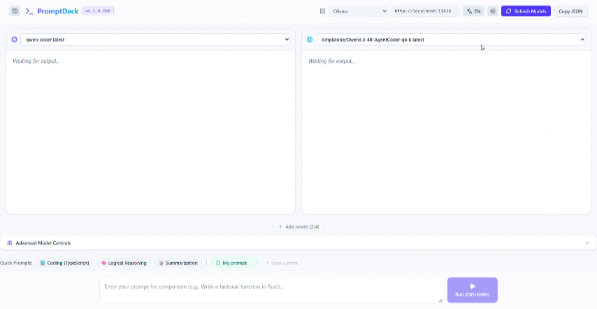 -->

# 🚀 PromptDeck

**English** | [中文](./README.zh.md) | [Русский](./README.ru.md)

**PromptDeck** is a local, open-source desktop studio for prompting and benchmarking LLMs side-by-side — fully offline, with no data ever leaving your machine.

Run the same prompt against multiple local models — via [Ollama](https://ollama.com), [LM Studio](https://lmstudio.ai), or a `llama.cpp` server — watch them stream in real time, and compare **Tokens/sec (TPS)**, **Time-To-First-Token (TTFT)**, and total duration, with results saved locally in SQLite for later review.

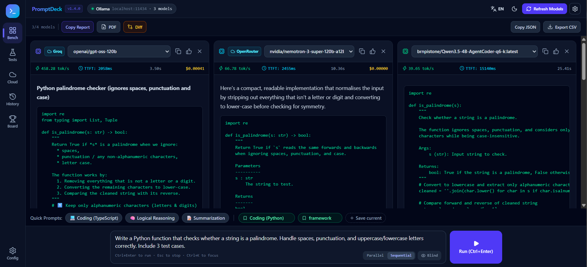
<!-- RETAKE for v1.0.0: new App Shell — icon-rail sidebar on the left, slim TopBar with provider pill, 2 model columns finished. Keep the same filename docs/screenshot-main.png and overwrite it -->

---

## ✨ Features

- 🧭 **App Shell workspace** — icon-rail sidebar (Bench, Tests, Cloud, History, Board, Config) plus a slim 48px TopBar with a provider connection pill (status dot, server URL, model count). Result actions live in a contextual toolbar that only appears when there are results, so model outputs always get maximum space
- 🔎 **Auto-detect & first-run onboarding** — PromptDeck scans the usual local ports (Ollama `11434`, LM Studio `1234`, llama.cpp `8080`) and offers one-click connect; when nothing is found, an onboarding card links straight to the Ollama / LM Studio installers
- ☁️ **Cloud providers** — manage OpenAI-compatible endpoints 9Router-style: curated catalog of 19 providers (OpenRouter, DeepSeek, Groq, Together AI, OpenAI, xAI Grok, Kimi, NVIDIA NIM, Ollama Cloud, Gemini, Kilo Gateway, Bazaarlink, BytePlus ModelArk, Poolside, Agnes, Xiaomi MiMo, Mistral, B.AI, Anthropic) split into Free Tier / API Key sections, custom endpoints, named API keys per provider with direct key-creation links, and a detail page with connection testing plus model picking (search, per-model 1-token probe, enable toggles)

  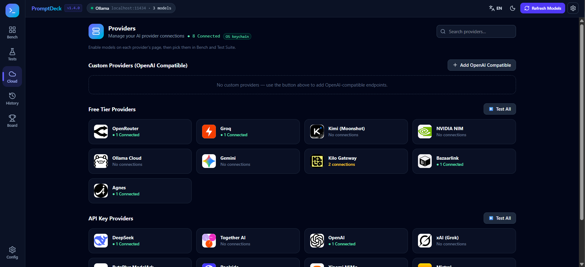
  <!-- NEW IMAGE for v1.1.0: open the Cloud page (cloud icon in sidebar), capture the Free Tier + API Key sections with a few connected cards. Save exactly as docs/screenshot-cloud.png -->

  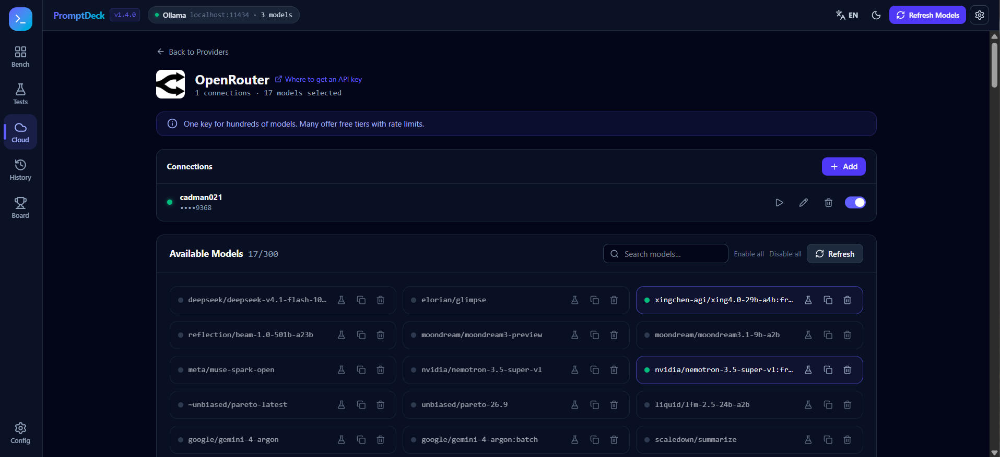
  <!-- NEW IMAGE for v1.1.0: click a provider card (e.g. OpenRouter), capture the Connections + Available Models sections. Save exactly as docs/screenshot-provider-detail.png -->

- ⚡ **Compare 2 to 4 models simultaneously** — run the same prompt across local and cloud models at once and watch them stream side-by-side, in Parallel or Sequential mode (sequential avoids GPU contention for cleaner local numbers)
- 🔁 **Repeat runs (1–5)** — medians reported with mean±stdev tooltips, so jitter doesn't decide the winner
- 💰 **Cost tracking** — per-run cost in Bench columns, per-model totals in Test Suite, frozen into history and exports (shown only when exact server tokens + provider pricing are known — never guessed)
- 🧠 **Thinking traces** — reasoning models show a collapsible Thinking block above the answer
- 🏆 **Winner votes & leaderboard** — crown the best answer per run and track Elo ratings plus average speed per model over time (a 4-model win moves more points than head-to-head)
- 🙈 **Blind voting** — hide model identities (columns, chart, diff) behind letter labels to vote without bias
- ⚖️ **LLM judge** — one model scores all outputs blind against a fixed rubric (accuracy/completeness/clarity), with an advisory pick badge; the human still crowns
- ✅ **Suite auto-checks** — per-test rules (contains/regex/exact/valid-JSON) with pass/fail badges and pass-rate summary

  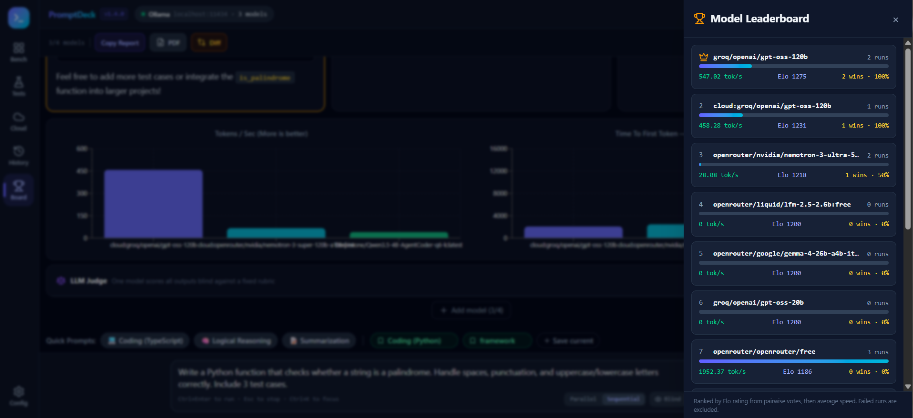
  <!-- Retake recommended: leaderboard panel now opens from the sidebar; capture with 2-3 models visible showing runs / avg TPS / wins. Keep filename docs/screenshot-leaderboard.png -->

- 🧪 **Test Suite (batch execution)** — run a list of 1–10 test prompts across all selected models sequentially and compare them in a scoreboard matrix: per-cell `tok/s`, 👑 crown for the fastest model on each test, heat-colored cells (relative speed per test), average-TPS + wins summary, click-to-read full outputs, Markdown copy, and CSV download
- 🧩 **Shareable test suites** — export a suite (prompts + auto-checks + selected models) to a JSON file and import one back, so benchmarks are reproducible across machines

  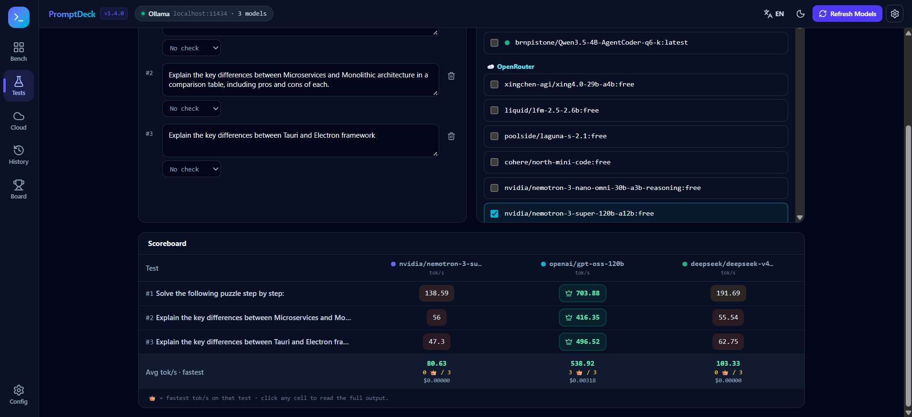
  <!-- NEW IMAGE for v1.0.0: open the Tests page (flask icon in sidebar), run a suite with 2+ models, capture the scoreboard table with crowns + summary row. Save exactly as docs/screenshot-testsuite.png -->

- 🔌 **Multi-provider support** — connect to [Ollama](https://ollama.com), [LM Studio](https://lmstudio.ai), or any `llama.cpp` server (OpenAI-compatible API)
- 📊 **Live metrics & visual charts** — TPS, TTFT, and total duration tracked per run, with bar charts comparing every model at a glance (`~` marks estimated TPS when the server doesn't report token usage)

  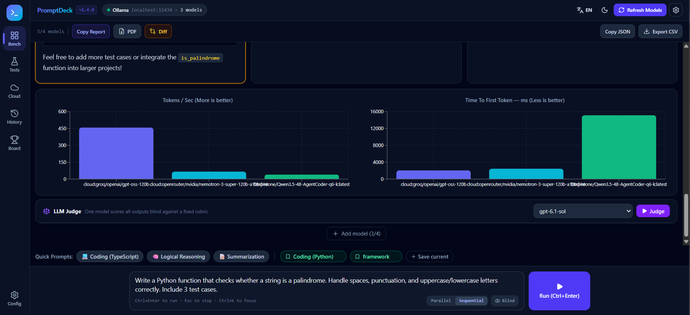
  <!-- Optional retake: TPS/TTFT comparison bar charts (estimated bars render slightly faded) -->

- 📡 **Live streaming feedback** — while a model runs, a phase strip shows Preparing → Generating with a running elapsed timer, a live `~tok/s` estimate, and a typing caret, so a slow first token never looks like a hang
- 🏁 **Bench verdict bar** — as soon as a run finishes, see the fastest, lowest-TTFT, and cheapest model at a glance, along with how much slower the slowest was (as a percentage)
- 🔍 **Side-by-side diff view** — compare any two outputs line-by-line with similarity percentage and added/removed counts

  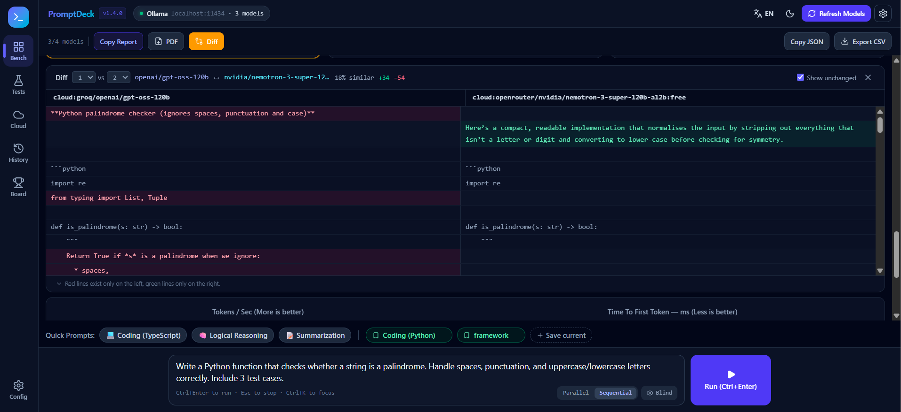
  <!-- Retake recommended: run a comparison, click Diff in the result toolbar, capture the diff panel with red/green lines. Keep filename docs/screenshot-diff.png -->

- 🕘 **Local history** — every benchmark run is saved to SQLite and browsed from a roomier sidebar: model chips (no truncation), winner crowns, `~` markers for estimated TPS, and header actions for Copy JSON, Export CSV, and full-database backup / restore

  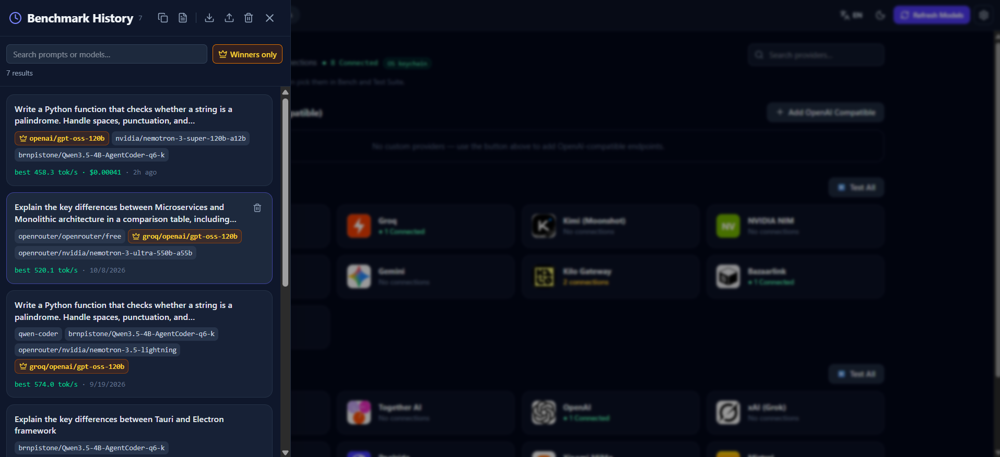
  <!-- History sidebar in light/dark mode -->

- 📝 **Markdown rendering** — model outputs render with full GFM support (tables, code blocks, etc.)
- 💻 **Highlighted code blocks** — fenced code gets a language label, a one-click copy button, and syntax highlighting that loads only _after_ the stream ends, so it never competes with local inference
- 💾 **Savable prompt presets** — save your own frequently-used prompts alongside the built-in quick presets

  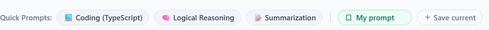
  <!-- Built-in + user-saved presets row -->

- 📄 **Rich PDF export** — export any benchmark run as a fully-formatted PDF report, preserving Markdown rendering (tables, code blocks, bold text)
- ⌨️ **Keyboard shortcuts** — `Ctrl+Enter` (or `Cmd+Enter`) to run, `Esc` to stop generation or close panels
- ⚙️ **Settings panel** — provider & connection, appearance, language, and advanced model controls (system prompt, temperature, top-p, context length) in a slide-over panel, all persisted across restarts

  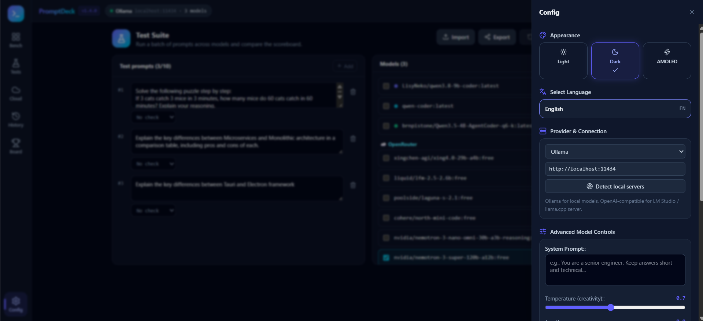
  <!-- NEW IMAGE for v1.0.0: open Config (gear icon, bottom of sidebar), capture the panel with Appearance + Language + Provider sections. Save exactly as docs/screenshot-settings.png -->

- 🌑 **Three themes** — Light, Dark, and **AMOLED Dark** (pure-black `#000000` canvas with neon glows). Cycle from the header or pick explicitly in settings

  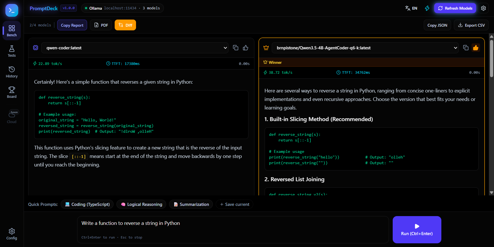
  <!-- NEW IMAGE for v1.0.0: same bench view as screenshot-main but with AMOLED theme active. Save exactly as docs/screenshot-amoled.png -->

- 🌍 **Language picker** — English, Deutsch, Français, 中文, Русский, and فارسی (full RTL support for Persian) in a grid-style popup, opened from the header or settings

  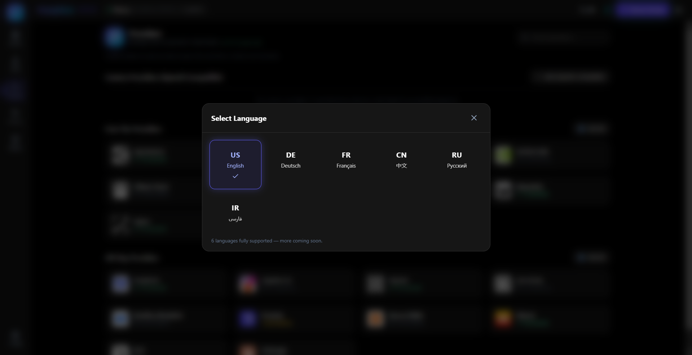
  <!-- NEW IMAGE for v1.0.0: click the language button in the TopBar, capture the centered Select Language modal. Save exactly as docs/screenshot-language.png -->

- 📋 **One-click export** — copy a Markdown report from the result toolbar, or grab the full JSON history / CSV from the history panel header
- 💾 **Backup & restore** — export/import the whole database (runs + presets) as JSON from the history sidebar
- 🔑 **OS-keychain secrets** — cloud API keys live in the OS credential store (auto-migrated), never in plaintext files
- 🔄 **Auto-update** — signed in-app updates from GitHub releases, with your consent — no manual downloads
- 🔒 **Local by default, private always** — built with [Tauri](https://tauri.app), no telemetry; cloud calls happen only to providers you explicitly configure with your own API key

---

## 🖥️ Tech Stack

| Layer      | Technology                                        |
| ---------- | ------------------------------------------------- |
| Shell      | [Tauri 2](https://tauri.app) (Rust)               |
| Frontend   | React + TypeScript + Vite                         |
| Styling    | Tailwind CSS v4                                   |
| State      | Zustand (persisted)                               |
| Database   | SQLite (via `tauri-plugin-sql`)                   |
| Charts     | Recharts                                          |
| PDF Export | jsPDF + autotable (text) / html2canvas (fallback) |
| Tests      | Vitest (`npm test`)                               |
| i18n       | react-i18next                                     |
| Markdown   | react-markdown + remark-gfm                       |
| Code       | react-syntax-highlighter (lazy-loaded)            |

---

## 📦 Prerequisites

Before running PromptDeck, make sure you have at least one local LLM backend running:

- **[Ollama](https://ollama.com)** — running locally (`ollama serve`), with at least one model pulled:
  ```bash
  ollama pull llama3
  ```
- **or [LM Studio](https://lmstudio.ai)** — with a model loaded and the local server started (Developer tab → Start Server)
- **or a [`llama.cpp` server](https://github.com/ggerganov/llama.cpp)** — running with its OpenAI-compatible endpoint enabled

You'll also need:

1. **[Rust](https://www.rust-lang.org/tools/install)** (stable toolchain)
2. **[Node.js](https://nodejs.org)** (v18+) and npm

---

## 🚀 Getting Started

```bash
# 1. Clone the repo
git clone https://github.com/Cadman021/prompt-deck.git
cd prompt-deck

# 2. Install dependencies
npm install

# 3. Run in development mode
npm run tauri dev
```

To build a production binary for your OS:

```bash
npm run tauri build
```

---

## 📸 How it works

1. Launch the app — it scans for local servers automatically (and also lets you pick a provider in the Config panel) and lists the available models; if nothing is running, an onboarding card helps you start one
2. For cloud models, open the **Cloud** page, add an API key on a provider, refresh its models, and enable the ones you want to use
3. On the **Bench** page, add up to 4 model columns (local and cloud mixable), write a prompt (or pick/save a preset)
4. Hit **Run** (or `Ctrl+Enter`) — all selected models stream their responses live
5. Compare TPS / TTFT instantly via the chart, crown a winner, open the **Diff** view for any two outputs, or check the **Leaderboard** for long-term stats
6. Need a deeper comparison? Switch to the **Tests** page, stack up to 10 prompts, hit **Run suite**, and read the scoreboard to see which model wins across the whole batch
7. Revisit past runs from the history sidebar, or export the whole report as PDF, Markdown, JSON, or CSV

---

## 🗺️ Roadmap

- [x] Cloud providers — catalog, API keys, model picking, and benchmarking in Bench + Test Suite
- [x] Cost estimation for cloud runs (per-run cost in Bench, totals in Test Suite; frozen into history)
- [x] Signed in-app auto-updates from GitHub releases
- [x] OS-keychain storage for API keys (auto-migrated, in-memory cache, silent fallback)
- [x] Test Suite — batch execution with scoreboard matrix
- [x] AMOLED Dark theme (+ Light / Dark)
- [x] Side-by-side diff view between two model outputs
- [x] Export benchmark history as CSV
- [x] Auto-detect local servers + first-run onboarding card
- [x] Shareable test suites (JSON export / import)
- [x] Live streaming phase, timer, and live tok/s
- [x] Syntax-highlighted, copyable code blocks
- [x] Per-model generation parameters — override temperature, top-p and max tokens per Bench column
- [x] Re-run any run from History with its prompt, columns and sampling settings
- [x] JSON Schema output checks in Test Suite
- [x] Cloud spend dashboard — totals, 30-day trend, by provider and model
- [x] Context sweep — tok/s and TTFT across 2K–64K context windows

Contributions and ideas are very welcome — see [Contributing](#-contributing) below.

---

## 🤝 Contributing

Issues and PRs are welcome! If you'd like to add a feature or fix a bug:

1. Fork the repo
2. Create a branch (`git checkout -b feature/my-feature`)
3. Commit your changes
4. Open a Pull Request

Please open an issue first for larger changes so we can discuss the approach. See [CONTRIBUTING.md](./CONTRIBUTING.md) for more details.

---

## 🙏 Contributors

Thanks to everyone who helps make PromptDeck better:

- [@AyanJaved](https://github.com/AyanJaved) — relative timestamps on history cards
- [@lb1192176991-lab](https://github.com/lb1192176991-lab) — winners-only filter, reset-to-defaults, Ctrl+K prompt focus
- [@afifm561](https://github.com/afifm561) — Test Suite retry-failed button

Want to join them? Look for [`good first issue`](https://github.com/Cadman021/prompt-deck/labels/good%20first%20issue) — newcomers welcome!

---

## 📄 License

This project is licensed under the [GNU General Public License v3.0](./LICENSE).

---

## ⭐ Support

If you find PromptDeck useful, consider giving it a star — it helps others discover the project and motivates continued development!
